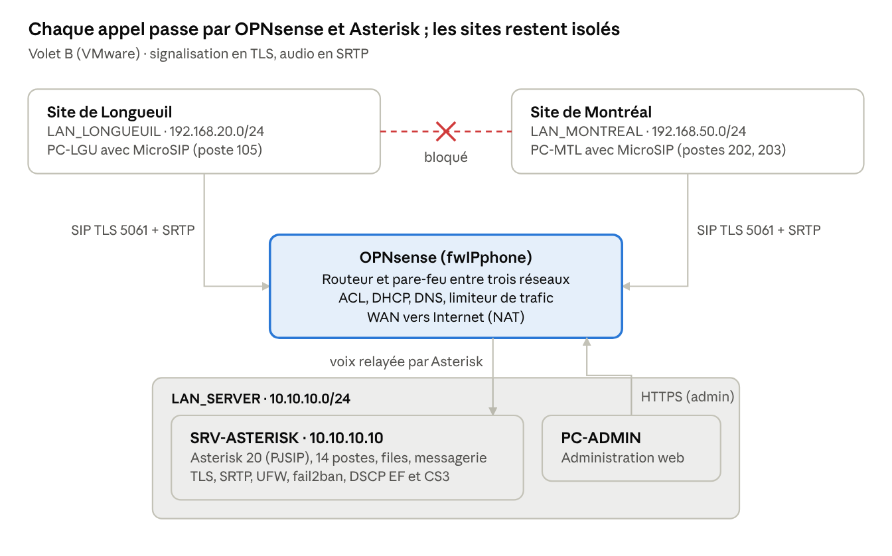

# 📞 Solution VoIP multisite sécurisée — Cisco CME, Asterisk et OPNsense

> Projet de fin de session — Téléphonie IP · AEC Sécurité informatique et réseaux, Collège Ellis
> **Kanga Koffi Sadrac (KKS)** — novembre 2026

Téléphonie IP complète pour une entreprise fictive de deux sites (Longueuil et Montréal) : 14 postes,
appels entre les sites, qualité de service et chiffrement de bout en bout, construite dans Cisco Packet Tracer
et dans un laboratoire VMware Workstation, puis validée par **43 tests**.



## 🎯 Objectifs

- Relier les deux sites par une téléphonie commune (plan de numérotation 1xx / 2xx)
- Séparer la voix et les données (VLAN voix, routage inter-VLAN)
- Garantir la qualité des appels (QoS, marquage DSCP, file prioritaire)
- Chiffrer la signalisation et la voix (VPN IPsec, SIP over TLS, SRTP)
- Protéger le serveur d'appels (pare-feu, isolement des sites, fail2ban)
- Prouver chaque résultat par un test et une capture

## 🧩 Les trois volets

| Volet | Environnement | Contenu |
|---|---|---|
| **A** | Cisco Packet Tracer | 2 routeurs 2901 en **Cisco CME**, 2 commutateurs 3560 PoE, 14 téléphones 7960 (SCCP), VLAN voix et données, DHCP option 150, dial-peers, **QoS LLQ** sur un WAN de 2 Mb/s, **VPN IPsec** AES-256, SSH v2 |
| **B** | VMware Workstation | **OPNsense** (routeur-pare-feu entre 3 réseaux), **Asterisk 20 / PJSIP** sur Ubuntu Server 24.04, 14 postes créés par script, files d'attente, accueil, messagerie vocale, **MicroSIP**, **SIP over TLS + SRTP** obligatoire, UFW, fail2ban |
| **C** | Appareils du volet B | **ACL** (OPNsense et UFW), limiteur de trafic OPNsense (files 70 / 20 / 10), marquage **DSCP EF (46)** et **CS3 (24)**, analyse des appels dans **Wireshark** |

## 🧰 Technologies

| Rôle | Solution |
|---|---|
| Serveur d'appels (volet A) | **Cisco CME** sur routeurs 2901 (licence uck9) |
| Serveur d'appels (volet B) | **Asterisk 20.6** (PJSIP) sur **Ubuntu Server 24.04** |
| Pare-feu, routage, DHCP, DNS, QoS | **OPNsense 26.1** (Dnsmasq, Unbound, Shaper) |
| Téléphones | Cisco 7960 (SCCP), **MicroSIP** 3.22 (SIP) |
| Sécurité | IPsec, TLS 1.2, SRTP (SDES), UFW, fail2ban |
| Analyse | Wireshark, tcpdump |
| Virtualisation | VMware Workstation |

## 🌐 Plan d'adressage

**Volet A — Packet Tracer**

| Site | VLAN | Rôle | Réseau | Passerelle |
|---|---|---|---|---|
| Longueuil | 10 | Données | 192.168.10.0/24 | 192.168.10.1 |
| Longueuil | 20 | Voix | 192.168.20.0/24 | 192.168.20.1 (CME, TFTP) |
| Montréal | 40 | Données | 192.168.40.0/24 | 192.168.40.1 |
| Montréal | 50 | Voix | 192.168.50.0/24 | 192.168.50.1 (CME, TFTP) |
| WAN | — | Lien série chiffré (IPsec) | 10.0.0.0/30 | — |

**Volet B — VMware**

| Réseau | Interface OPNsense | Réseau IP | Contenu |
|---|---|---|---|
| LAN_SERVER | em1 | 10.10.10.0/24 | SRV-ASTERISK (10.10.10.10), PC-ADMIN |
| LAN_LONGUEUIL | em2 | 192.168.20.0/24 | PC-LGU (MicroSIP) |
| LAN_MONTREAL | em3 | 192.168.50.0/24 | PC-MTL (MicroSIP) |
| WAN | em0 | DHCP (NAT) | Accès Internet |

## 🔐 Points de sécurité mis en œuvre

- **Chiffrement de bout en bout** : VPN IPsec AES-256 entre les sites (volet A), SIP over TLS sur le port 5061 et SRTP obligatoire (`media_encryption_optimistic=no`) dans le volet B.
- **Isolement des sites** : les postes de Longueuil et de Montréal ne se joignent jamais directement ; OPNsense ne laisse passer que la signalisation et l'audio vers Asterisk.
- **Défense en profondeur** : règles OPNsense par alias **et** pare-feu UFW sur le serveur ; port SIP en clair (5060) fermé.
- **Protection contre la force brute** : fail2ban bannit une adresse après 5 échecs d'authentification.
- **Secrets protégés** : mots de passe SIP et NIP aléatoires générés par script, fichiers en 640 (`root:asterisk`), clé privée TLS en 600.
- **Durcissement Cisco** : SSH v2 seulement, ports inutilisés désactivés, bannière d'avertissement.

## ✅ Résultats

| Mesure | Résultat |
|---|---|
| Pertes de paquets audio | **0 %** sur 4 flux G.711 (Wireshark) |
| Gigue | **< 0,05 ms** (seuil VoIP : 30 ms) |
| Marquage de l'audio / de la signalisation | **DSCP 46 (EF)** / **DSCP 24 (CS3)** |
| Écoute d'un appel | Rejouable en clair, **impossible** une fois chiffré |
| Priorité sous charge | Voix en file prioritaire pendant un téléchargement de 11,4 Mo |
| Tests | **43 tests réussis**, chacun prouvé par une capture |

Détail : [tests/plan-de-tests.md](tests/plan-de-tests.md) — rapport complet : [docs/Rapport_VoIP_Kanga.pdf](docs/Rapport_VoIP_Kanga.pdf)

## 🧩 Défis rencontrés

| Problème | Cause | Solution |
|---|---|---|
| Tunnel IPsec bloqué (MM_NO_STATE) | Politiques ISAKMP différentes entre les deux routeurs | Ligne `encryption aes 256` ajoutée sur R-MONTREAL ; tunnel en QM_IDLE |
| Postes Windows en 169.254.x.x | DHCP d'OPNsense (Dnsmasq) actif sur une seule interface | Interfaces et plage de Montréal ajoutées |
| fail2ban ne bannissait jamais | Ubuntu 24.04 lisait le journal systemd, où Asterisk n'écrit pas les échecs | `backend = polling` sur `messages.log` |
| Appel non répondu coupé | Conflit entre variantes du module de messagerie | `noload` dans la section `[modules]` |
| tracert bloqué | Règle ICMP placée sous une règle de blocage | Règle remontée : la première qui correspond s'applique |

Les 22 problèmes sont documentés dans [docs/journal-des-problemes.md](docs/journal-des-problemes.md).

## 📁 Contenu du dépôt

```
├── README.md
├── docs/            Rapport technique, fiche portfolio, schéma, journal des problèmes
├── configs/
│   ├── packet-tracer/   Routeurs CME (VLAN, DHCP, QoS, IPsec) et commutateurs
│   ├── asterisk/        pjsip.conf (modèles, TLS, SRTP), extensions, files, messagerie
│   ├── serveur-ubuntu/  Netplan, UFW, fail2ban
│   └── opnsense/        Interfaces, alias, règles, limiteur de trafic
├── scripts/         Création des 14 postes, certificat TLS
├── tests/           Plan de tests (volets A, B et C) avec résultats
└── captures/        Preuves des tests
```

## ⚠️ Limites du prototype

Un seul serveur Asterisk (point de défaillance unique), certificat autosigné, aucun trunk SIP vers un fournisseur,
annonces en anglais. En production : serveurs d'appels redondants, certificat d'une autorité reconnue,
trunk SIP protégé par un SBC, et supervision des appels.

---
*Aucun mot de passe, NIP, clé VPN ni clé privée n'est publié dans ce dépôt : les valeurs sensibles sont remplacées par `<mot-de-passe>`, `<cle-vpn>`, etc.*
